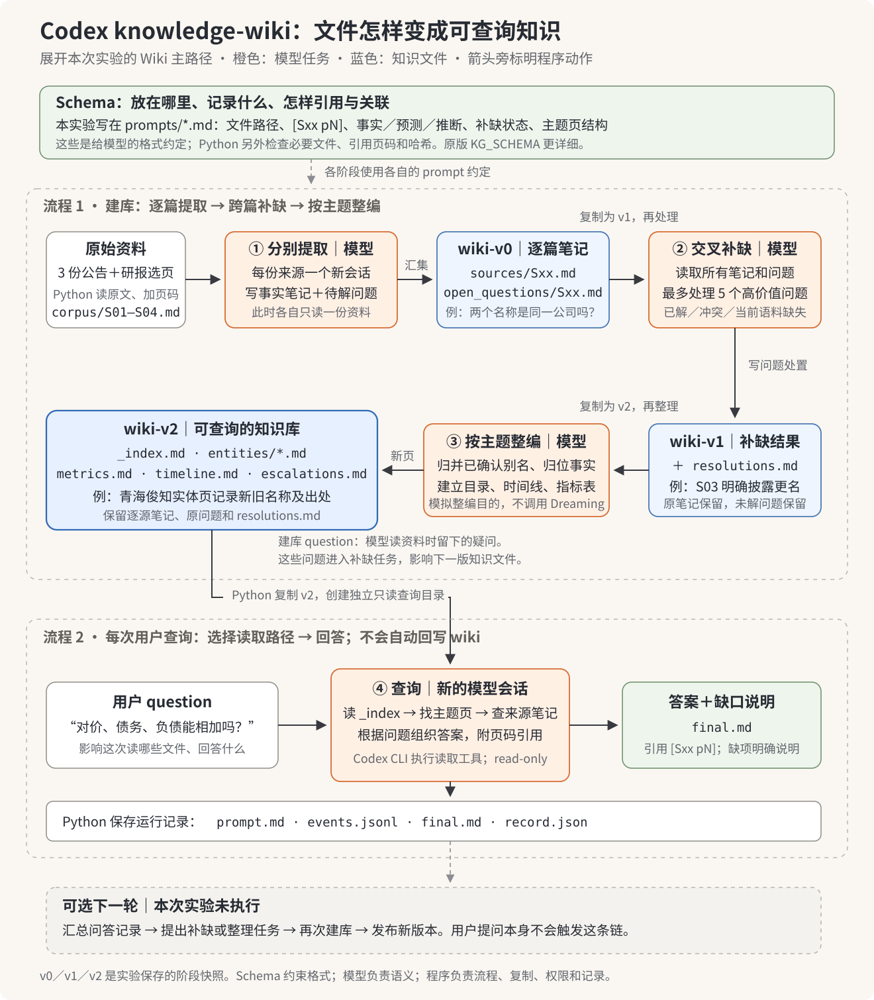

# 用 Codex 跑一次 knowledge-wiki

这个实验让你沿实际源码观察：**Python 控制任务和产物，模型理解内容并选择工具操作，Codex CLI 执行 Agent 的工具循环。**



不需要 Claude Managed Agents、Dreaming API、向量库或模型训练。本地文件保存知识；Codex 使用你已有的 CLI 登录和配置的模型。本实验依然调用远程模型，并非离线推理。

## 图解：Schema 与两类 question

[打开 Schema 与 question 架构图 SVG](assets/schema-questions.svg) · [PNG 预览](assets/schema-questions.png)。图中展开建库和 Wiki 查询主线，不含原文对照旁路；灰色问答回流是本实验没有执行的可选下一轮。

Schema 是“文件放哪里、记录保留哪些信息、引用和链接怎样写”的约定。原版在 notebook 的 `KG_SCHEMA` 字符串中要求实体 YAML、按源 metrics/relations、双链和出处；本实验简化为各阶段 prompt 中的 Markdown 文件约定，没有要求实体 YAML，也没有独立 JSON Schema 文件。

```text
逐源提取约定：sources/Sxx.md + open_questions/Sxx.md
事实引用约定：重要事实附 [Sxx pN]，保留日期、单位、口径、事实/预测/推断属性
补缺约定：resolutions.md，标 RESOLVED / CONFLICT / MISSING_IN_CORPUS
整编约定：_index.md + entities/*.md + metrics.md + timeline.md + escalations.md
```

| 问题类型 | 从哪里来 | 影响什么 | 写出什么 |
|---|---|---|---|
| 建库 `open_questions` | 模型读单份资料时发现疑问 | resolver交叉查证、整编时形成主题事实或缺口 | `resolutions.md`，后续主题页或缺口清单 |
| 用户查询 `question` | `run.py` 的 `QUESTIONS` 或使用者 | 本次检索路径、需要的解释和答案 | `logs/qxx/final.md` 和prompt/事件/用量记录 |

四个测试问题虽然预先登记，当前代码只在查询阶段把它们传给模型；它们没有传入提取、补缺和整编任务。固定Wiki上换一个问题，不会改写Wiki，也不会自动向`open_questions/`追加缺口或触发取数。若希望研究问题指导建库，需要显式把问题传入上游prompt；若希望问答经验回流，需要另行启动整理/补缺并发布新版本。

## 运行

需要 Python 3.12、已登录的 Codex CLI、PATH 中的 `pdftotext`（Poppler），以及 `corpus_config.json` 所绑定的本机原始文件。所有 Python 代码只依赖标准库。

```bash
cd managed-agents/knowledge-wiki/codex-spike
codex login status
python3.12 run.py --minutes 30 --workers 2
```

只准备资料、不调用模型：

```bash
python3.12 run.py --prepare-only
```

完整运行会在 wiki 查询后，用同样的四个问题做原文对照（`raw-q01`…`raw-q04`）。给已完成的旧 run 补对照、不重建 wiki：

```bash
python3.12 run.py --baseline-for runs/20261020T084430389111Z
```

它只新增 `baseline/`、`logs/raw-*` 和 `COMPARISON.md`，并在 `stages.json` 中追加记录；不改 `REPORT.md` 和 wiki 快照。

每次运行创建新的 `runs/<UTC时间>/`，不覆盖旧实验。默认继承 CLI 的模型，仅对本次调用把 reasoning effort 设为 `medium`，可用 `--effort` 修改。默认单任务超时 300 秒，整体预算 30 分钟；超时留下已执行产物并标记 incomplete。没有自动重跑模型任务，避免把重复执行混进第一次结果。

`runs/` 被 Git 忽略。原始 PDF 不复制进仓库；来源项目和原件库只读。

## 第一次实际运行

已完成 [第一次运行报告](runs/20261020T084430389111Z/REPORT.md)：4份来源、18页，10个独立Codex会话，含4个只读查询。模型调用链约9分钟，前期选料与实现另计。程序检查通过；四个查询的19条命令均只读取相对`wiki/`文件，查询前后文件哈希一致。

最直观的例子是：研报提取者在 `extract/S04/notes/open_questions/S04.md` 留下“Qinghai Zhongli 与 Qinghai Trigiant 是否同一主体”的问题；resolver 从 S03 笔记找到明确更名披露，写入 `wiki-v1/resolutions.md`；整编后归入 `wiki-v2/entities/qinghai-trigiant.md`。Python 没有为这两个名字写匹配规则，语义关联由模型完成。

原文抽样与一处保留的非核心措辞歧义见 [READBACK.md](READBACK.md)。

## 原文对照（baseline）

对照组用同样的 CLI 参数、同样的回答规则，只把知识来源从 `wiki/` 换成 `raw/`（抽取者读的那份逐页原文和同一份 `_sources.json`）。第一次 run 补跑后的结果见 [COMPARISON.md](runs/20261020T084430389111Z/COMPARISON.md)：

| 四题合计 | 输入 token | 其中未缓存 | 输出 | 工具调用 |
|---|---:|---:|---:|---:|
| wiki | 294,787 | 59,523 | 2,564 | 19 |
| 原文 | 310,279 | 58,375 | 2,908 | 26 |

在这个规模上几乎打平：wiki 每题少约 3,900 输入 token（约 5%），未缓存部分基本相同；而建 wiki 花了约 58.7 万输入 token，按 token 数约 150 题才回本。答案质量也接近：关键金额、日期、口径和"语料无法回答"的边界一致。原因是语料只有约 4.9 万字符，wiki-v2（约 5.6 万字符）比原文还大，每次会话的固定开销又占输入的大头。原示例的省钱结论需要更大的语料才看得出来；这里只演示机制。每格 n=1。

原文组的检索方式和 wiki 组不同：先 `rg` 搜关键词，再 `sed -n` 读行区间；wiki 组从 `_index.md` 开始，按路径 `cat` 整个文件。8 个查询 trace 都只读各自的 `wiki/` 或 `raw/`（`out_of_scope_commands()` 审计为 0）。

## 从哪里读源码

| 顺序 | 入口 | 程序做什么 | 模型做什么 |
|---|---|---|---|
| 1 | `prepare_corpus.py::prepare()` | 核对哈希，复制原文页或用 pdftotext 提取选页，加来源标记 | 没有模型调用 |
| 2 | `run.py::Pipeline.extract()` | 每份来源一个独立目录，准备 input/source.md | 根据 extract prompt 生成来源笔记和问题 |
| 3 | `run.py::Pipeline.call()` | 启动 codex exec，保存 prompt、JSONL、回答、耗时和文件变化 | 由 Codex runtime 调模型、执行其工具请求 |
| 4 | `run.py::Pipeline.run()` 的 v0 合并 | 把每份来源笔记原样复制，不作语义合并 | 无 |
| 5 | `prompts/resolve.md` | 复制 v0 为 v1，启动一个新 CLI 会话 | 交叉读笔记，回答最多五个问题或记录缺口 |
| 6 | `prompts/consolidate.md` | 复制 v1 为 v2，启动新会话，保留旧版本 | 去重、归位、建索引、时间线、指标表和实体页 |
| 7 | `prompts/query.md` | 四个问题分别创建新会话和只读工作目录 | 从索引找相关文件，检索、阅读、引用、回答 |
| 8 | `run.py::Pipeline.baseline()` + `prompts/baseline.md` | 同样四题，只读工作目录只放原文 `raw/`；汇总两组用量 | 在原文里搜索、阅读、引用、回答 |

顶层 `inspect_events()` 是事件观察器。它解析 CLI 已发出的事件；实际工具循环在 Codex CLI runtime 内，不在本项目的 Python 代码中。

## 产物链

```text
runs/<run>/
├── corpus/                 原文输入，加来源和页码
├── corpus-manifest.json    原件、文本和规范化文件的路径与哈希
├── questions.json          模型输出前固定的四个问题
├── extract/S01/
│   ├── input/source.md
│   └── notes/
│       ├── sources/S01.md
│       └── open_questions/S01.md
├── wiki-v0/                程序合并的逐源笔记
├── wiki-v1/                模型补缺后的新副本
├── wiki-v2/                模型整编后的新副本
│   ├── _index.md
│   ├── entities/
│   ├── metrics.md
│   ├── timeline.md
│   ├── escalations.md
│   └── sources/            不可变的逐源笔记仍保留
├── query/q01/wiki/         仅包含已整理 wiki 的查询工作副本
├── baseline/q01/raw/       仅包含逐页原文的对照查询工作副本
├── logs/<stage>/
│   ├── prompt.md           程序交给模型的任务
│   ├── events.jsonl        Codex CLI 原始事件，包括工具调用及结果
│   ├── stderr.log
│   ├── final.md            模型最终回复
│   └── record.json         命令、thread_id、用量、前后哈希和变更文件
├── stages.json
├── snapshots.json
├── result.json
├── REPORT.md               各阶段运行结果、wiki/原文对照表及两组答案
└── COMPARISON.md           仅 --baseline-for 补跑时生成
```

最有用的阅读顺序是：`logs/extract-S02/prompt.md` → 其 `events.jsonl` → `wiki-v0/sources/S02.md` → `wiki-v1/resolutions.md` → `wiki-v2/_index.md` → `logs/q02/events.jsonl` → `logs/q02/final.md`。这条路径可以直接看到模型如何把一份原文变成后面可检索的笔记。

例如第一次q02实际执行的三条命令：

```text
cat wiki/_index.md
cat wiki/metrics.md wiki/entities/acquisition.md wiki/escalations.md
cat wiki/sources/S02.md wiki/sources/S03.md wiki/sources/S04.md
```

程序没有预选top-k文件，也没有将全库拼进问题。模型在Codex runtime里逐步选择读取路径，然后回答。

## 和原始示例的对应关系

| Claude 示例 | 这个实验 |
|---|---|
| Hosted memory store | 本地 wiki 目录 |
| Managed Agent session | 全新 codex exec 进程/会话 |
| Hosted Agent tool loop | Codex CLI runtime |
| Store attachment instructions | prompts/ 中的任务规范 |
| Dreaming | 普通 Codex 整编任务，不声称复现 Dreaming 内部算法 |
| 新 store ID | 新 wiki-vN 目录 |
| Read-only store | read-only sandbox 和前后文件哈希对比 |

为减少实验中的并发覆盖，本实验让每份来源独立生成 `sources/<id>.md` 和问题清单，再由程序合并、模型集中建立实体页面。原示例的按源 metrics/relations 与共享 entity 写法在这里被简化了。

## 哪些是程序保证，哪些依靠模型

程序核对原始输入哈希、必要产物存在、已识别引用的来源与页码、来源笔记不被后续改写、旧版本不变，以及查询目录没有写入。`end_turn`/退出码成功只代表任务正常结束。

提取是否完整、金额口径是否理解正确、引用是否真正支持论断、缺口是否判断准确，仍需回读原文。结构检查不等于研究验收。当前引用检查也不证明每一条事实都带引用。

查询使用 read-only sandbox，关闭本次 CLI 调用的 memories、apps、plugins、multi_agent 功能，提示只读 wiki，并保留工具 trace。只读约束写入；“只能读 wiki”的来源范围还依赖 prompt 与 trace 审计，不应把它当成操作系统级读取隔离。

语料包含 2026-10-05 研报，只选了该研报第 2、5 页。不能把它当作 2026-09-30 截点的正式投研数据集，也不能把选页未见等同于整份文件未披露。详见 [CORPUS.md](CORPUS.md)。

CLI 调用方式依据 [OpenAI 官方非交互模式文档](https://learn.chatgpt.com/docs/non-interactive-mode)，本机以 `codex exec --help` 和实际事件为准。
