# wiki-lab 设计：wiki 这种形态能不能用于 AI 投研

状态：设计稿，未实现。日期：2026-10-21。这一轮只建 wiki、看内容：俊知和长飞两份公司 wiki，加一份光纤行业 wiki。不进入研究任务，也不做组间对照。



## 1. wiki 是什么，改用后得到什么

wiki 是每个研究对象（一家公司、一个行业、宏观）各一份持续更新的研究底账。它记录截至某个截点，我们对这个对象知道什么、怎么理解、上次判断过什么、还缺什么，以及每一条出自哪里。目的是提高研究的效率和准确：下一轮研究从底账起步，不再从原文重新拼；已经理清的口径和踩过的坑跟着对象走，不随某一轮结束而散掉。

在 invest-lab 里，它放在两类已有资产之间：一类是按来源组织的共享证据（`invest-sources/evidence/`），一类是每轮冻结、带研究结论的交接包（`research/<层>/<对象>/v<N>/`）。M 每轮整理的作者视图（如俊知研究轮的 `pre-price/`）只服务那一轮。wiki 按对象组织，跨轮累积，用的时候按截点过滤。

### 1.1 交付什么

| 内容 | 回答什么问题 | 俊知的例子 |
| --- | --- | --- |
| 主体与关系 | 谁是谁、谁控制谁、关系从何时到何时 | 青海中利是更名前的青海俊知；中利集团是历史上的出售方，不是别名 |
| 事件时间线 | 发生了什么、哪一步还没发生 | 2025-12-12 出售方董事会批准出售 → … → 2026-09-24 俊知完成收购；中间缺失的股权变动标成缺口 |
| 指标与口径 | 关键数字是多少、指什么、能不能这样用 | 收购偿付义务含利息，不能整笔当有息本金；名义产能不等于有效产能 |
| 研究判断 | 上次怎么判断的、依据是什么、什么变化会推翻它 | 三期"过户后六个月内开产"的承诺不等于满产 |
| 缺口 | 缺什么、查过哪里、还值不值得再查 | 2015 认购：检索已超出预算并停止，有新资料时才重开 |
| 教训 | 上一轮在哪里出过错 | source_id 不能写成别名；不是逐字的摘录不能放进原文字段 |
| 入口页 | 哪类问题先读哪几页 | `_index.md` |

每个事实和数字都带原文页码和披露日，读者不必回原文就能用，要核对时一步就能找到。研究里正式采用某个数字时，仍以原文和 invest-lab 的证据为准。

行业和宏观 wiki 用同样的格式，内容不同。行业 wiki 放产品与单位定义、价格序列的来源及哪些不能拼接、宣布 / 名义 / 有效产能台账、竞争对手及各自位置、各份研报覆盖了什么。宏观 wiki 放分地区的指标含义、政策时间线、云厂商和运营商资本开支指引的历次版本、数据序列的口径。这一轮只做两家公司和光纤行业，宏观留到以后。

"研究判断"和"教训"来自 invest-lab 的研究轮回写（第 13 节），这一轮先不做，wiki 里只有从资料里整理出来的内容。

### 1.2 在 invest-lab 各环节怎么用

| 环节 | 现在 | 改用 wiki 后 |
| --- | --- | --- |
| 每轮开工 | 作者从 M 整理的作者视图和原文重新建立全貌；俊知研究轮的作者视图有 1,066 个文件，官方披露 931 页 | 先读入口页和相关的实体、时间线、指标页，再按引用回原文核对 |
| 收到新资料 | 作者自己判断新资料影响哪些旧结论 | 增量把新资料对到主体、旧缺口和相关页面上，列出改了什么，作者逐条确认 |
| M 派补料 | 已查范围记在各轮台账里，同一缺口会被反复检索（俊知研究轮的 2015 认购出现在 5 批） | 先查缺口；停查的不再派，有新资料涉及它时再重开 |
| 一轮结束 | 口径裁定和教训散在 `run-state.md`、`errors.md` 和各作者包里 | 回写进对象的 wiki，下一轮直接继承 |
| 下游 V、R、W | 查某个口径或判断的出处，要翻上一轮的交接包和运行目录 | 从 wiki 条目直接跳到出处、限定条件和失效条件 |
| 同行业第二家公司 | 复用某一截点的行业交接包 | 另外复用行业 wiki 的定义、价格序列来源、产能台账和不能拼接的关系，按新截点过滤 |
| 随手提问 | 没有入口 | `ask.py` 只读查询 |

### 1.3 它不是什么

- **暂不替代证据库。** wiki 的来源笔记本身就是带页码的摘录，可以直接用来定位和引用原文。但 invest-lab 的证据还要经过资格裁定（截点、版本、转引关系），由 D-抄录唯一写入，wiki 没有这套治理；两边并存时说法不一致，以原文为准。如果这一轮证明笔记质量够高，下一步可以让 D-抄录直接从 wiki 笔记取材再裁定，省掉重复抽取。
- **不是交接包。** 交接包是某一轮、某个截点、经 M 接收的结论。wiki 里的判断只是"带出处的上次判断"，不会自动成为当前结论；下一轮是否采用，仍由作者写进自己的交接包。
- **不产生新证据，也不替作者下判断。** 文档里没有的东西，wiki 照样没有；它能做的是把缺口和已查范围记清楚。

### 1.4 什么时候不值得

- **只研究一次的对象。** 价值要从第二次使用才开始体现。
- **维护跟不上。** 新资料不做增量、研究轮不回写，wiki 就会过期。过期的 wiki 比没有更危险，因为下一轮会继承过期的内容。
- **wiki 自己出错。** 误认主体、把预测写成实绩，都会被下一轮继承。所以每条都带页码，主体合并要有原文依据，再加程序检查和人工抽查（第 11 节）。
- **数字为主的内容。** 财务三表、价格和产量序列更适合放在表格或数据库里（Wind、Choice、证据层）。wiki 适合理解性的内容：关系、事件、口径、判断和缺口；它的指标页是带出处的摘要，不是数据源。

## 2. 这一轮做什么

**目标**：用 invest-sources 里的真实资料建三份 wiki，看它们产出什么内容，由你直接判断这种形态能不能用于 AI 投研、要改哪里。

- **俊知（1300.HK）公司 wiki**：资料最全，有收购、更名、私有化、股东变化这类跨文件的关系，能看出实体和时间线做得好不好。
- **长飞（601869.SH / 6869.HK）公司 wiki**：五年年报加 2026 中报，以财务和分部为主，能看出 wiki 处理数字密集资料的效果。
- **光纤行业 wiki**：两家公司的行业章节、四家同行（亨通、中天、烽火、长芯博创）的 2026 中报管理层讨论、几份研报。能看出行业页能否把多家公司的说法放在一起，并和公司页连起来。

**判断方式**：你读 wiki、随手提问，我抽查关键事实回原文核对（第 9 节）。不设对照组，不冻结评分要点，不跑研究任务。

**这一轮不做**：研究任务和组间对照、研究轮回写、看价前视图、宏观 wiki、回本计算。确认形态可用之后，再决定是否接入 invest-lab、怎么接（第 13 节）。

运行方式和 [codex-spike](../codex-spike/) 一样：Python 负责编排，每个阶段启动一个新的 `codex exec` 会话，模型通过 Codex 的工具读写文件。

## 3. 语料

### 3.1 范围

原件全部从 `/Users/leon/Stock/invest-sources` 只读读取，用 `manifests/sources.jsonl` 里的 `source_id` 定位，逐页文字在 `text/<source_id>/p0001.txt`。不复制原件进仓库；每次运行把用到的逐页文字复制到 `runs/<run>/corpus/`（被 Git 忽略），并记下 SHA-256。

| 对象 | 资料 | 规模（按逐页文字） |
| --- | --- | --- |
| 俊知 | 1300.HK 全部有逐页文字的披露：年报、中报、招股书、2023 私有化通函与公告、2026 公告；DBS 10/5 研报、光大 9/17 交流会纪要 | 36 份，1,638 页，约 486 万字符 |
| 长飞 | 2021–2025 年报、2026 中报、中期分红和股东会公告、9/24 投资者交流记录；华创、华泰、国联民生三份中报点评 | 13 份，1,427 页，约 247 万字符 |
| 光纤行业 | 美银 8/28 中天点评；亨通、中天、烽火、长芯博创 2026 中报的管理层讨论章节（P0 定页码范围）；两家公司资料里的行业章节直接复用公司笔记，不重复抽取 | 新增约 25–45 万字符 |
| 留作增量 | 002309 的 2025-098 公告（俊知）；瑞银 9/23 光纤行业报告和长飞首次覆盖（行业、长飞） | 3 份，约 13 万字符；第 8 节 |

瑞银行业报告是行业资料里最完整的一份，故意留作增量：首次构建不含它，增量时加入，正好看"新研报到了，行业页改了什么"。

不纳入：没有逐页文字的条目（长飞空芯光纤合同的网页发布、H 股奖励计划、权益披露表 `hkex-di-cs20260121e00003`）；Wind / Choice / iFinD 的原始返回（是数据接口的 JSON，不是文档）。

### 3.2 编号、截点和市场内容

- 按披露日首次分配 `S01`…，之后冻结 `source_id → 短编号` 注册表；增量只追加，不重排。`_sources.json` 保存 source_id、短编号、披露日、原件和逐页文字哈希。
- 引用格式沿用 spike：`[S12 p34]`，页码是 PDF 页序。
- 截点统一为 2026-10-15，披露日晚于截点的不进。每条事实都带披露日，按披露日筛选可用来源；按历史截点重建页面以后设计，不能用版本 tag 代替（第 5.1 节）。
- 行情、目标价、评级、估值倍数和私有化每股作价这类内容，只写进 `market/`，其他页面不引用。以后 invest-lab 需要看价前视图，直接排除这个目录即可。

### 3.3 切块

- 按页切，不拆页。一块最多约 10 万字符；单页超过上限的（极少见）单独成块。
- 小公告合并：同一类型、披露日相邻的小文件（例如 9 份月报表）合成一块，每页仍保留各自的 `[SOURCE: Sxx]` 和 `[PAGE: N]` 标记。
- 单来源块编号如 `S05.c03`，多来源合块用独立编号如 `C001`。`chunks.json` 记录每块包含的 source_id、页码和文本哈希。
- 三个对象合计约 770 万字符，估计 75–85 块。招股书（2012，约 135 万字符）是第一个可以推迟的文件。

### 3.4 抽取保留什么

同类任务复用固定的提取约定，写入 `prompts/extract.md`：

- 数字连同主体、指标定义、单位、币种、期间、合并范围、实际 / 指引 / 预测性质一起保留。
- 影响用法的关键原话保留短摘录，包括付款与投产期限、起算点、退款 / 没收条件、偿债支持义务和本金 / 利息组成。背景可以归纳，不能把这些条件压成一个总数。
- 表格保留表头、行列对应、负号和相关脚注。遇到跨块续表或缺少定义，记下待回查页码，不自行补足。
- 每条笔记标层级：`公司:trigiant`、`公司:yofc`、`行业:optical-fiber`、`宏观`、`市场`。一条可以有多个标签，例如长飞年报里的行业供需描述同时标公司和行业。
- 研报里的机构预测和判断照原性质标注，不当实绩；多家研报转引同一个出处（如 CRU）的，记下共同出处。
- 每块附简短覆盖说明：已读页码、重要表格 / 条款是否覆盖、没提取的内容在哪及原因。
- P1 人工对照原文抽查上述内容；哈希、页数或文件存在，不能证明内容完整。

## 4. 流水线

| 阶段 | 程序做什么 | 模型做什么 | 产出 |
| --- | --- | --- | --- |
| 0 准备 | 读清单、按截点筛选、核对哈希、复制逐页文字、切块、冻结编号 | 无 | `corpus/`、`corpus-manifest.json`、`chunks.json` |
| 1 抽取 ×N | 每块一个工作目录，只放这一块；并发启动；检查产物格式 | 读原文，写笔记（带页码和层级标签）、提到的主体、这份资料没说清的事 | `sources/`、`mentions/`、`gaps/` |
| 2 汇集 | 原样拷进 wiki 仓库；把所有"提到的主体"汇成名字索引；提交 | 无 | `_mentions_index.json` |
| 3a 整编：实体 | 校验 frontmatter、别名唯一、链接可达 | 合并别名，建实体页，写关系和有效期 | `entities/` |
| 3b 整编：公司页 ×2 | 只给该公司标签的笔记和相关实体页 | 写概览、业务与分部、时间线、指标、风险、缺口 | `companies/<公司>/` |
| 3c 整编：行业页 | 只给行业标签的笔记和两家公司页 | 写概览、产品与单位、需求、价格、供给与产能、参与者、缺口；链接到公司页 | `industries/optical-fiber/` |
| 3d 整编：入口 | 校验所有引用页码存在、已有笔记不变 | 合并重复缺口，写入口页 | `_index.md` |
| 4 补缺（一次） | 统计回查页数 | 对缺口先搜笔记；重要的在页数上限内回查原文；写状态 | 更新各 `gaps.md`，发布 `wiki-v1` |
| 5 增量 | 只抽新块；按名字、层级标签、链接和引用列出候选页面和缺口 | 逐个确认，合并改写受影响的页面，重看相关缺口 | `changes.md`，发布 `wiki-v2` |

抽取在每块自己的工作目录里进行。之后的阶段也不直接改 wiki，而是在临时工作区里改，检查通过才写回并提交。版本是提交上的 tag，不再复制整个目录（第 5.1 节）。

## 5. Wiki 的格式

```text
runs/<run>/wiki/               独立 git 仓库；版本是 tag，不是目录
├── _index.md                  入口：三个对象各从哪几页读起
├── _sources.json              短编号 ↔ source_id、披露日、哈希、页数、截点（程序写）
├── _mentions_index.json       所有"提到的主体"按名字汇总（程序写，可重建）
├── sources/S05/c03.md         逐块笔记，带页码和层级标签（抽取写，之后只增不改）
├── mentions/S05/c03.json      这一块里出现的主体（抽取写）
├── gaps/S05-c03.json          这一块没说清的事（抽取写）
├── entities/<slug>.md         主体页：公司、子公司、股东、交易对手、同行（整编写）
├── companies/trigiant/        overview / segments / timeline / metrics / risks / gaps
├── companies/yofc/            同上
├── industries/optical-fiber/  overview / products / demand / prices / supply / players / gaps
├── market/                    行情、目标价、评级、估值倍数；其他页面不引用
└── changes.md                 每次构建和增量改了什么、为什么
```

给人读的页面用 markdown；需要程序检查的部分（实体 frontmatter、缺口状态）用固定字段。

### 5.1 版本和发布

只有一个 wiki 目录，历史交给 git。

- **放在哪**：`runs/<run>/wiki/` 是独立的 git 仓库，不进 claude-quickstarts，因为里面有研报摘录；`runs/` 被本仓库忽略。P2 首次构建和 P4 增量用同一个仓库。长期放在哪，接入 invest-lab 时再定（第 13 节）。
- **提交和发布**：每个阶段通过检查后提交一次。发布是打在提交上的附注 tag，这一轮只有两个：`wiki-v1`（补缺后）和 `wiki-v2`（增量后）。看某个阶段改了什么，用相邻两次提交的 `git diff`；看两次发布之间改了什么，用 `git diff wiki-v1 wiki-v2`。
- **一个发布固定一套状态**：页面、逐块笔记和 `_sources.json`（来源集合、哈希、截点）在同一个提交里，旧发布不会混进后来的笔记。运行日志和 `ask.py` 的输出记提交哈希，不只记 tag 名。
- **在临时工作区里改**：整编类阶段（3a–3d、4、5）的会话不直接改 wiki 仓库。程序把这一步要改的页面和要读的笔记拷进工作区；会话结束后运行 `checks.py`，通过才写回并提交。不通过的改动提交到单独的分支（如 `rejected/<阶段>`）供查看，主线和已发布的 tag 都不变。
- **查询只读发布**：`ask.py` 用 `git worktree` 检出最新的 tag 来读，不读正在修改的目录。
- **tag 不是历史截点**：tag 记的是 wiki 什么时候写了什么，不是市场什么时候知道什么。瑞银 9/23 的报告不在 `wiki-v1` 里，但 9/23 之后它就是公开的。按披露日筛选可用来源；这一轮截点固定为 2026-10-15，按历史截点重建页面以后设计。

### 5.2 每条细节一个归属页

页面之间的重复比版本之间的重复更危险：同一个数字写在三页上，增量时漏改一处，wiki 就自相矛盾。

- 事件经过放 `timeline.md`；公司的数字和口径放 `metrics.md`，行业的价格和产能放 `prices.md`、`supply.md`；主体的别名、关系和有效期放实体页。
- 概览和其他页面只写一句摘要，并链接到归属页，不重抄细节。
- 摘要里写了当前状态的（如"收购已完成"），归属页一变它也得改。所以增量时，链接到被改页面的摘要也要复核（第 8 节）。
- 来源笔记保留每份资料各自的原话，不受这条限制。

## 6. 实体页

本节示例里的 `[S25 p4]` 这类引用编号都是示意，实际编号由阶段 0 分配。

### 6.1 抽取时记录"提到的主体"

每块抽取除了笔记，还写一份 `mentions/<块>.json`。抽取者只记原文里出现的名字和身份信息，**不做合并判断**：

```json
[
  {"name": "Qinghai Zhongli Optical Fibre Technology Co., Ltd.",
   "name_zh": "青海中利光纤技术有限公司",
   "role": "收购标的", "identifiers": {},
   "facts": ["2013-07-05 成立"], "cite": "[S25 p4]"}
]
```

程序把所有 `mentions` 汇成 `_mentions_index.json`：同一个名字出现在哪些块、哪些页。这一步不调模型。

### 6.2 整编时建实体页

整编会话读名字索引和相关笔记，决定哪些名字是同一主体，每个主体写一页：

```markdown
---
name: qinghai-trigiant
canonical: 青海俊知光纤技术有限公司 / Qinghai Trigiant Optical Fibre Technology Co., Ltd.
type: company
aliases:
  - text: 青海中利光纤技术有限公司 / Qinghai Zhongli Optical Fibre Technology Co., Ltd.
    kind: former_name
    valid_to: 2026-09-24
    cite: "[S27 p1]"
relations:
  - {rel: subsidiary_of, target: trigiant-group, valid_from: 2026-09-24, cite: "[S27 p1]"}
candidate_links: []
---
- 2013-07-05 成立，生产光纤预制棒、光纤 [S25 p4]
- 一期、二期在产年产能 400 吨，三期 600 吨待投产 [S27 p2]
```

规则：

- **同一性必须有原文依据**：例如公告写明"更名为"。只有名字相似、没有依据的，放进 `candidate_links` 并写理由，不合并。把两个主体误合成一个，比不合并更危险。
- **关系带有效期**：股权换手、更名都保留历史。未知的生效 / 交割日期写 null 并说明，不能用董事会批准日、协议日或披露日代替。
- **同行跨对象共用**：中天、亨通这类公司可能同时出现在两家公司的资料和行业资料里，只建一页，各对象都链接它。
- **程序检查**：frontmatter 能解析；同一个别名不能出现在两个实体上；链接都指向存在的页；每条事实都有引用，且页码存在。

## 7. 缺口

缺口不是预设的问题清单，而是抽取时发现的"这份资料提到了、但没说清的事"。例如收购公告提到卖方，却没说卖方当初花多少钱取得标的；年报提到产能扩张，却没给投产时间。它们记下了 wiki 的边界：哪些事资料里有答案，哪些事要另找资料。对投研来说，知道缺什么、查过哪里，和知道什么一样有用。

它们也不必搞成一套重流程，这一轮只做三件事：

1. **抽取时记**：每块写 `gaps/<块>.json`，一条一件事，写清缺什么、原文在哪提到的、最可能在哪找到答案。只记真实疑问，不为凑数而提问。
2. **整编时合并**：同一件事的多条合成一条，挂到相关公司或行业页的 `gaps.md`，并链接相关实体。
3. **补缺一次**：先在笔记里找；重要的（影响主体身份、交易阶段、金额口径或时间线的）在页数上限内回查原文。每条最后写一个状态：

| 状态 | 写什么 |
| --- | --- |
| 已解决 | 答案和引用 |
| 资料里没有 | 查过哪些来源和页码，还需要什么文件；结论只限这批资料 |
| 没查完 | 为什么没查完，还要查什么 |

只在笔记里没找到、没回查原文的，只能写"没查完"，不能写"资料里没有"。增量时，新资料涉及的缺口重看一遍。

## 8. 增量

首次构建得到 `wiki-v1` 后，补入留下的三份资料，得到 `wiki-v2`：

- **俊知 + 002309 公告**：应新增"中利集团"实体页（002309.SZ），写明它是青海中利的历史出售方，与青海中利是交易关系，不是别名；协议股权价款 951,461.90 元和 2025-12-12 董事会批准分别记录，实际交割日仍未知，不能据此设定持股关系的结束日。年报董事履历里的 "Zhongli Sci-Tech Group" 只能留在 `candidate_links`，除非原文证明是同一家。相关缺口（卖方取得价款等）应重新处置。
- **长飞、行业 + 瑞银 9/23 两份**：机构预测和判断（价格展望、产品分配与价格层级、采购折让、有效供给释放时点）应进入行业页的对应位置，标为机构判断，不改写已有的公司实绩；"more than Rmb130-150/fkm" 这类表述保持原措辞，不转成区间；目标价和评级只进 `market/`。

三份资料作为一批处理：一次增量、一次提交、一个发布，不是每份资料各出一版。以后日常使用也一样，新资料攒一批再增量，比如每轮研究开工前一次。

**找候选页面。** 只按名字匹配不够：瑞银行业报告里的价格展望、有效供给释放时点会影响价格页和供给页，却未必提到哪个实体。程序按三条线列候选，取并集：

- 名字：新块 `mentions` 里的名字匹配实体名和别名；
- 层级标签：新笔记带 `行业:optical-fiber` 的，该行业所有页面都列入；带 `公司:<slug>` 的，该公司所有页面；带 `市场` 的，`market/`；
- 链接和引用：引用同一来源或同一数据序列的页面。会话改完后，程序再列出链接到已改页面、但这次没动的页面，交会话复核一遍。

整编会话逐个确认：改了的写明改了什么、为什么，没改的写一句理由。字符串匹配会漏掉第一次出现的名字，所以 `changes.md` 也要人工看一遍。

**怎么改页面。** 合并改写，不在页面末尾追加"据 Sxx 披露……"：

- 事件推进了（如从董事会批准到完成交割），概览改成最新状态，旧状态压成时间线上的一行；
- 定期数据（月报表、中报）续写进已有的表；
- 多份资料引用同一出处（如 CRU）：期间、产品、单位、口径都一致时，合成一条，带多个引用 `[S12 p5; S40 p8]`；不一致就并列，注明共同出处，不取平均；
- 新资料涉及的缺口改状态，不删条目。

`changes.md` 写给人读：改了哪些结论、为什么，看过但没改的候选页面及理由。逐行差异看 `git diff wiki-v1 wiki-v2`。

## 9. 怎么看结果

不做组间对照，直接看 wiki 本身。五项，每项都由你判断，我准备材料：

1. **能不能快速读懂**：每个对象从入口页开始读，读完概览和它链接的几页后，能否讲清业务结构、关键事件、主要风险和还缺什么。
2. **准不准**：我每个对象抽约 20 条关键事实和数字回原文页核对，记下错误类型（主体误并、口径混用、预测写成实绩、页码不支持）；你复核其中一部分。
3. **关系和口径理没理清**：按下面的清单逐项看。
4. **随手问**：用 `ask.py` 问你平时会问的问题，看答案能否直接从 wiki 得到、引用对不对、缺的时候有没有说清缺什么。
5. **新资料能不能接上**：看 `changes.md` 和 `git diff wiki-v1 wiki-v2`，第 8 节列的变化是否改对、改全，有没有改了不该改的；列为候选但没改的页面，理由是否成立。

查看清单（方向）：

| 对象 | 看什么 |
| --- | --- |
| 俊知 | 青海收购的链条：主体、对价与支付安排、偿付义务里本金和利息的区分、9/24 完成、三期产能与开产承诺；2023 私有化的提出方、价格和结果（价格在 `market/`）；股东与关联方；分部（电力电缆、通信馈线、光纤）的口径；2026 年利润跃升里经营改善和一次性项各占多少 |
| 长飞 | 分部口径，以及 2024 年分类调整前后不机械接续；A+H 两地上市的股本口径；年报、中报的实绩与管理层表述、研报预测分开；中报点评之间说法不同时并列，不取平均 |
| 光纤行业 | G.652.D 价格的现货、集采、CRU 转引和公司 ASP 分开，不拼接；宣布、名义、有效产能分开；有棒和无棒厂商的利润分配；需求池（运营商、数据中心、海外光纤到户）；长飞、亨通、中天、烽火、长芯博创、俊知各自的位置，以及能否从行业页跳到公司页 |

结论分三档：能用；改了格式或流程后能用（写明改什么）；不适合（写明原因）。

## 10. 成本

记录每个阶段的输入 token（缓存 / 未缓存分列）、输出 token、会话数和耗时，计入失败与重试；宿主不提供计费时金额写 null。

- 抽取约 75–85 个会话，整编 5–6 个，补缺按缺口数分批，增量 1–2 次。
- spike 中 1–2 万字符文件的抽取约 70–90 秒、约 8 万输入 token（含大量缓存），只作参考。10 万字符一块的实际开销由 P1 测，再估全量。
- 这一轮的成本数字用来判断"建一份 wiki 要多少钱和时间"，不算回本。

## 11. 程序检查和人工判断

| 程序保证 | 依靠模型，靠人工抽查 |
| --- | --- |
| 原件哈希一致，只读不改 | 读懂原文，包括双栏排版的研报 |
| 已有的逐块笔记不被修改（重抽某块要单独提交并写明原因）；每个阶段只改它负责的路径；检查不通过的改动不进主线 | 抽取是否完整、关键定义和条件是否保留 |
| 实体 frontmatter 格式、别名不重复、链接可达 | 哪些名字是同一主体，关系和有效期是否正确 |
| 引用的来源和页码存在 | 引用的那一页是否真的支持这句话 |
| 每条缺口有状态；"资料里没有"必须写查过哪里 | 缺口结论是否正确 |
| 除 `market/` 外的页面不出现目标价、评级等市场词 | 是否仍有可反推股价的组合 |

程序检查只证明结构对，不证明内容对。内容要靠第 9 节的阅读和抽查。wiki 内容不自动成为 invest-lab 已接收的证据或研究判断。

## 12. 步骤

| 阶段 | 内容 | 看什么 |
| --- | --- | --- |
| P0 准备 | 三个对象的资料清单、截点、切块；留出增量资料；定同行中报的页码范围 | 清单和规模符合第 3 节 |
| P1 小样 | 青海三份公告、长飞 2026 中报、美银研报，跑完抽取和整编 | 你先看格式和写法，调整 prompt；记录每块用量，估算全量 |
| P2 全量构建 | 三个对象一起建，发布 `wiki-v1` | 程序检查通过 |
| P3 阅读和抽查 | 第 9 节第 1–4 项 | 你的判断和要改的地方 |
| P4 增量 | 补入三份资料，发布 `wiki-v2` | 第 9 节第 5 项 |
| P5 结论 | 能用 / 改后能用 / 不适合；要不要接入 invest-lab | 第 13 节的下一步 |

## 13. 以后再说

形态确认可用之后，再考虑接入 invest-lab。届时要补的是：

- **研究轮回写**：把每轮的口径裁定、研究判断（带依据、反证、失效条件）、缺口已查范围和教训写回对象 wiki。
- **看价前视图**：排除 `market/`，并按 invest-lab 每轮的读取白名单过滤来源。
- **研究里的效果**：新作者接手、收到新资料、行业包滚动这几种场景下，带 wiki 和不带 wiki 各做一次，看省了多少、准了多少；再算建设和维护的成本几轮能收回。
- **与 D-抄录 的分工**：来源笔记能否作为 D-抄录 的取材起点。
- **宏观 wiki** 和同行业更多公司。

## 14. 计划中的文件

现在只有本文和架构图。实现时预计新增（都在 `wiki-lab/` 下）：

| 文件 | 作用 |
| --- | --- |
| `corpus.py` | 阶段 0：读 invest-sources 清单、截点筛选、切块 |
| `run.py` | 阶段 1–5，编排 `codex exec`，复用 spike 的 `Pipeline.call()` |
| `ask.py` | 随手提问，只读 |
| `checks.py` | 所有程序检查，也可以单独对某个提交或 tag 运行 |
| `prompts/*.md` | 各阶段的任务说明 |
| `runs/` | 每次运行的产物，包括 wiki 仓库 `runs/<run>/wiki/`；被本仓库忽略 |
| `.gitignore` | 忽略 `runs/`；在 `runs/` 里建 wiki 仓库之前就要加上 |

## 15. 待定事项

- 招股书（2012）是否先推迟，等 P1 的成本出来再定。
- 同行中报只取管理层讨论章节，还是加上分部附注。
- 两份公司研报（DBS、光大纪要）里的经营估计放公司页还是只放研报笔记：它们是机构预测，容易被当成事实。
- 并发数：由 Codex 的速率限制决定，P1 时测。
